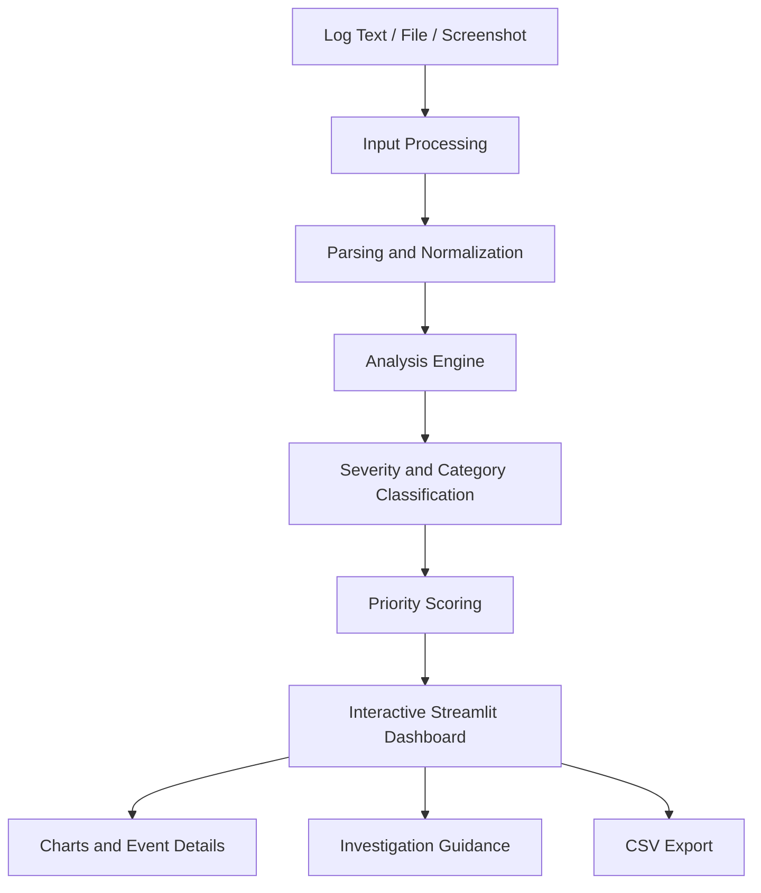

# LogAnomaly — Universal Log Monitor

**An interactive log analysis dashboard for identifying suspicious events, prioritizing errors, and investigating application and server logs.**

<p align="center">
  
  
  
  
</p>

<p align="center">
  <a href="https://5btjft2gtk7rtzpiwmtw8f.streamlit.app/"><strong>Launch Live App</strong></a> ·
  <a href="#-features">Features</a> ·
  <a href="#-installation">Installation</a> ·
  <a href="#-usage">Usage</a>
</p>

---

## Overview

**LogAnomaly** is a Python-based web application that helps users examine server and application logs through an interactive dashboard. It processes log entries, categorizes events, highlights potentially significant errors, and assigns review-priority scores to help users identify which events deserve attention first.

Instead of manually scanning lengthy log files, users can submit log data and inspect the analysis through visualizations, event summaries, and investigation guidance.

### Live Demo

**[Open LogAnomaly →](https://5btjft2gtk7rtzpiwmtw8f.streamlit.app/)**

## Features

- **Flexible log input** — paste log text or upload supported log files and screenshots.
- **Log preprocessing** — parse and normalize entries for analysis.
- **Severity classification** — identify events such as warnings, errors, and critical failures using implemented rules.
- **Anomaly prioritization** — assign scores to help prioritize suspicious or important entries.
- **Event categorization** — organize log events into meaningful groups.
- **Interactive visualizations** — explore event scores and analysis summaries through charts.
- **Investigation guidance** — display suggested checks for examining potential issues.
- **Exportable results** — download analysis data in CSV format where supported.
- **Dark-themed interface** — explore results in a monitoring-oriented dashboard.

## Tech Stack

| Technology | Role |
|---|---|
| Python | Core application and analysis logic |
| Streamlit | Interactive web interface |
| Regular expressions | Log parsing and pattern matching |
| Pandas | Tabular data processing, where used |
| Plotting libraries | Dashboard visualizations |
| Git and GitHub | Version control and source hosting |
| Streamlit Community Cloud | Application deployment |

## Architecture



The workflow represents the application's high-level processing pipeline. The exact analysis and scoring behavior depends on the current implementation.

## Project Structure

```text
LogAnomaly-/
├── .streamlit/                 # Streamlit configuration
├── tests/                      # Analysis engine tests
├── analysis_engine.py          # Log processing and analysis logic
├── app.py                      # Streamlit application
├── requirements.txt            # Python dependencies
├── sample_logs.txt             # Sample log data
├── start_windows.bat           # Windows startup script
└── README.md                   # Project documentation
```

## Installation

### Prerequisites

- Python installed on your system
- Git
- A terminal or Visual Studio Code

### 1. Clone the repository

```bash
git clone https://github.com/areeb07-star/LogAnomaly-.git
cd LogAnomaly-
```

### 2. Create a virtual environment

**Windows PowerShell:**

```powershell
python -m venv venv
.\venv\Scripts\Activate.ps1
```

If PowerShell blocks activation, you can use Command Prompt instead:

```bat
venv\Scripts\activate.bat
```

### 3. Install dependencies

```bash
python -m pip install -r requirements.txt
```

### 4. Start the application

```bash
streamlit run app.py
```

Open the local URL displayed in your terminal to access the dashboard.

## Usage

1. Launch the application.
2. Paste log entries or upload a supported input file.
3. Run the analysis using the interface.
4. Review severity classifications, categories, and priority scores.
5. Explore the charts and expand individual events for additional details.
6. Use the suggested investigation steps to guide further checks.
7. Export the results if the export option is available.

### Example Input

```text
2026-10-24 10:01:12 INFO Application started successfully
2026-10-24 10:02:45 WARNING High memory usage detected
2026-10-24 10:03:18 ERROR Database connection failed
2026-10-24 10:04:07 ERROR Authentication failed for user admin
2026-10-24 10:05:31 CRITICAL Resource exhaustion detected
```

The dashboard can highlight important entries for review according to its implemented parsing and scoring rules. Results are indicative and should be verified against the original logs.

## Testing

The repository contains a `tests/` directory for testing the analysis engine.

Install the test dependency if required:

```bash
python -m pip install pytest
```

Run the tests from the project root:

```bash
python -m pytest
```

## Deployment

LogAnomaly is hosted on Streamlit Community Cloud.

**Live URL:** https://5btjft2gtk7rtzpiwmtw8f.streamlit.app/

To publish updates:

1. Commit your changes to the connected GitHub repository.
2. Push the changes to the configured branch.
3. Wait for Streamlit Community Cloud to rebuild the application.
4. Reboot the app from its management menu if a restart is necessary.

## Limitations

- Rule-based analysis may produce false positives or miss unfamiliar events.
- Priority scores indicate review priority, not confirmed malicious activity.
- Log formats and incomplete entries can affect parsing accuracy.
- Screenshot analysis can be affected by image quality and OCR errors.
- N-gram novelty scoring should be considered an implemented feature only when it is integrated into the current analysis pipeline.

## Roadmap

Potential improvements include:

- Integrating unigram, bigram, and trigram probability scoring.
- Improving anomaly detection with contextual and temporal analysis.
- Supporting additional log formats and datasets.
- Adding configurable alerts and advanced filtering.
- Expanding automated testing and performance evaluation.

## Contributing

Contributions and suggestions are welcome.

1. Fork the repository.
2. Create a feature branch.
3. Make and test your changes.
4. Submit a pull request describing the improvement.

## License

No license has been specified yet. Add a `LICENSE` file before distributing the project under an open-source license.

---

<p align="center">
  <strong>LogAnomaly</strong><br>
  Making log investigation clearer, faster, and more accessible.
</p>
